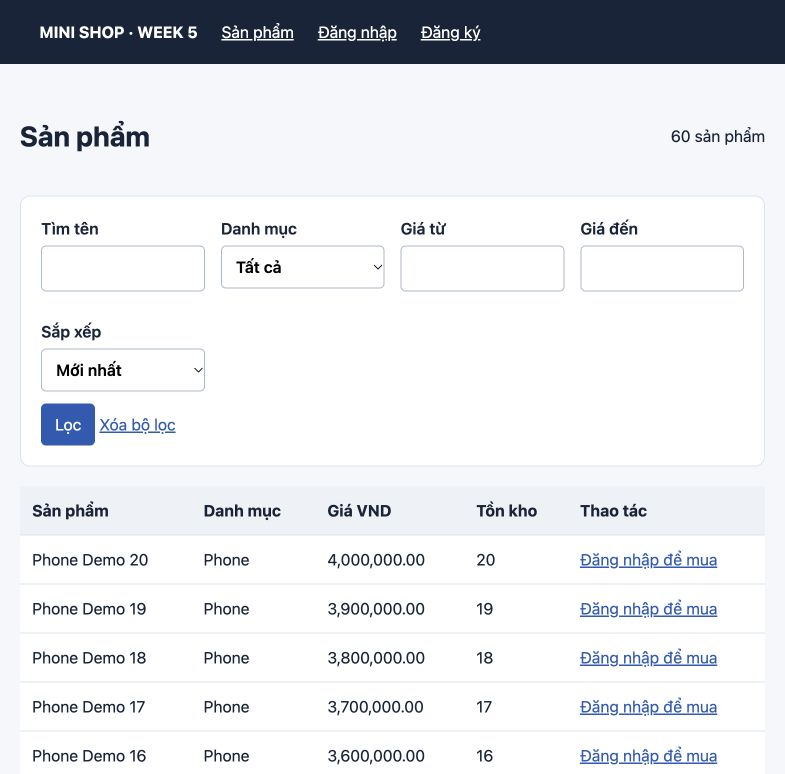

# Mini Shop — Laravel Modules + MVC / MySQL

[Live Demo](https://54.252.208.88/products) · [GitHub](https://github.com/Thanhlong282828/demo-aws) · [API documentation](docs/api.md) · [Học D29–D35](docs/START-HERE.md)

Mini Shop là portfolio Junior PHP/Laravel: đăng ký → đăng nhập → giỏ hàng → checkout → xem đơn; admin quản lý sản phẩm, danh mục và trạng thái đơn. Week 5 bổ sung REST API, kiểm thử và triển khai HTTPS. Project có hỗ trợ AI; bài thi không AI chưa được thực hiện thay người học.

## Features

- Web session auth, role ADMIN/USER, CSRF và ownership.
- Product/Category CRUD, tìm kiếm, lọc, phân trang.
- Cart, checkout transaction với lock tồn kho, idempotency token; snapshot tên/giá đơn hàng.
- Coupon từ Week 4; không thêm tính năng thương mại ngoài scope.
- API Product, Category, Order; Sanctum bearer token có hạn 8 giờ và revoke.
- JSON Resources, validation, HTTP status 200/201/401/403/404/422/429.
- 82 PHPUnit tests / 338 assertions PASS trên MySQL; 35 HTTP smoke checks qua HTTPS PASS.

## Tech stack & architecture

PHP 8.4.1+ theo composer.lock (production 8.5), Laravel 13, `nwidart/laravel-modules` 13, Sanctum 4, MySQL 8, Blade, PHPUnit 12, Nginx/PHP-FPM, AWS EC2 Ubuntu 26.04.

```text
Modules/Product: routes → Controllers → Form Requests → Product Model → Blade web views
Modules/Category: routes → Controllers → Form Requests → Category Model → Blade web views
Modules/Shop: auth/cart/order routes → Controllers → CartService/CheckoutService → Models
app/Http/Resources: representation JSON dùng chung
```

API controllers trả JSON; web controllers trả Blade/redirect. Business checkout nằm trong service, dùng lại giữa các caller. Xem [database & architecture](docs/architecture.md).

## Screenshots



## Installation

Yêu cầu PHP 8.4.1+ với pdo_mysql, mbstring, xml, curl, zip, bcmath, intl; Composer 2; MySQL 8. Blade hiện dùng CSS inline nên không cần npm để chạy website này.

```bash
git clone https://github.com/Thanhlong282828/demo-aws.git
cd demo-aws
mkdir -p storage/framework/cache/data storage/framework/sessions storage/framework/views storage/logs bootstrap/cache
composer install --no-interaction
cp .env.example .env
```

Tạo database local bằng tài khoản MySQL có quyền CREATE DATABASE:

```bash
mysql -u root -p
```

Trong MySQL:

```sql
CREATE DATABASE minishop_week5 CHARACTER SET utf8mb4 COLLATE utf8mb4_unicode_ci;
CREATE DATABASE minishop_week5_test CHARACTER SET utf8mb4 COLLATE utf8mb4_unicode_ci;
```

Sửa `.env`: DB_CONNECTION=mysql, DB_HOST/DB_PORT, DB_DATABASE=minishop_week5, DB_USERNAME/DB_PASSWORD theo MySQL của bạn. Không dùng secret production. User DB local cần quyền trên cả database app và database test. File `.env` được ignore.

```bash
php artisan key:generate --no-interaction
php artisan migrate --seed --no-interaction
php artisan test --compact
php artisan serve --host=127.0.0.1 --port=8005
```

Mở [local](http://127.0.0.1:8005/products). MySQL server phải đang chạy. Không chạy test khi cấu hình DB trỏ production. Test suite cố định database riêng `minishop_week5_test` trong phpunit.xml, dùng RefreshDatabase.

## Demo accounts

| Role | Email | Password |
| --- | --- | --- |
| Admin | admin@minishop.test | DemoShop2026! |
| User | user@minishop.test | DemoShop2026! |

Các tài khoản trên chỉ dành demo. Local seeder tạo tự động; production chỉ seed demo account khi `DEMO_ACCOUNTS=true`. Không đưa tài khoản cá nhân lên demo.

## API

Base URL production `https://54.252.208.88/api`; local `http://127.0.0.1:8005/api`.

```bash
curl -H 'Accept: application/json' https://54.252.208.88/api/products
```

Authentication: `POST /api/login` với email/password demo → lấy `data.token`; gửi `Authorization: Bearer <token>` ở request bảo vệ. `POST /api/logout` revoke token hiện tại. Web auth vẫn dùng session/CSRF.

Products: GET list/detail public; POST/PUT/PATCH/DELETE admin. Categories tương tự. Orders GET list/detail chỉ own orders, kể cả admin ở user endpoint; admin dùng GET /api/admin/orders, PUT /api/admin/orders/{id}/status. Không có API checkout mới; dùng web flow sẵn có.

[Full endpoint matrix, input/output/status](docs/api.md) · [Permission matrix](docs/api-permissions.md).

## Postman

Import [Collection](docs/postman/Mini-Shop-API.postman_collection.json) và [local environment](docs/postman/local.postman_environment.json) hoặc [production environment](docs/postman/production.postman_environment.json). Chọn environment, chạy Authentication → Login; script tự lưu token. Token export mặc định rỗng. Request ghi dữ liệu nên chạy local trước. Xem [D31](docs/D31.md).

## Testing

```bash
php artisan test --compact
php artisan test --compact --filter=Week5ApiTest
php artisan test --compact --filter=midcheckout_failure
```

[Test report](docs/test-results.md) và [regression experiment](docs/D32.md). Không có tuyên bố 100% coverage hoặc mọi lỗi đều được loại bỏ.

## Deployment

[Runbook D34](docs/D34.md): AWS EC2 t3.micro, MySQL cùng VPS, Nginx/PHP-FPM, APP_DEBUG=false; HTTPS Let’s Encrypt cho IP và systemd tự gia hạn. Public IP tự cấp có thể thay đổi sau stop/start: khi đó phải cập nhật URL và cấp lại certificate. Credit AWS có hạn, không phải hosting miễn phí vĩnh viễn.

## Release & learning status

[Release checklist](docs/release-checklist.md) · [Release notes](docs/release-notes.md). Bài Live Change 45 phút không AI, Project Defense và 16 applications do người học tự hoàn thành; không đánh dấu giả. D35 kỹ thuật và phát hành được ghi theo bằng chứng thực tế.
